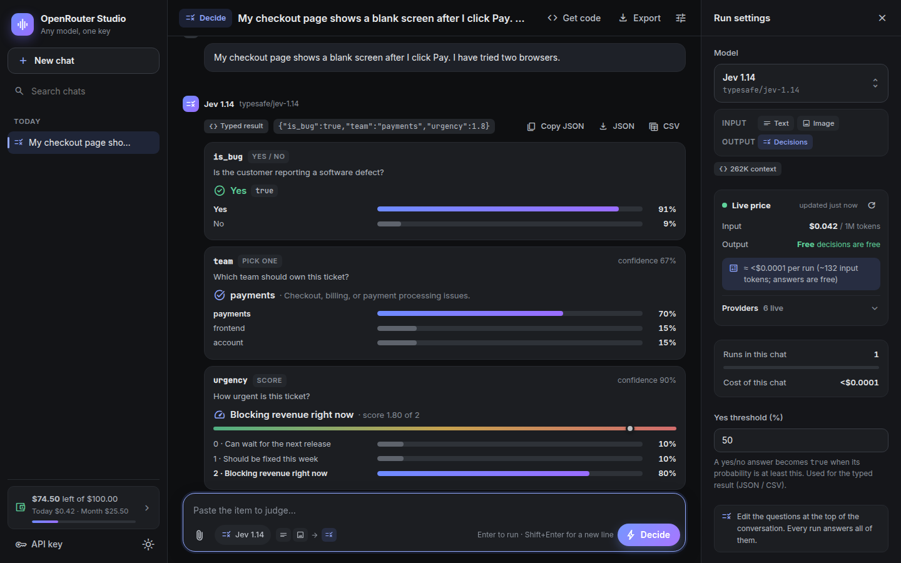
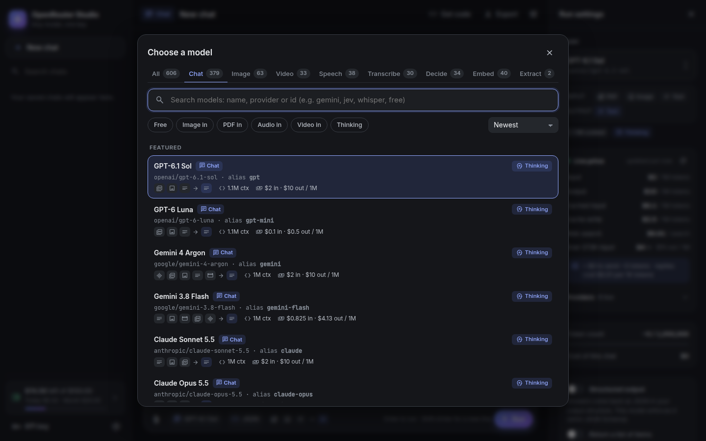
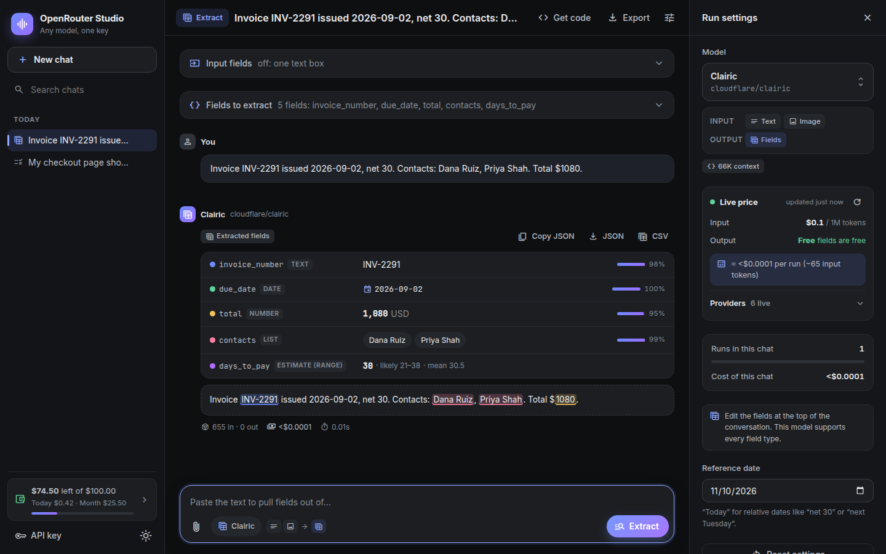
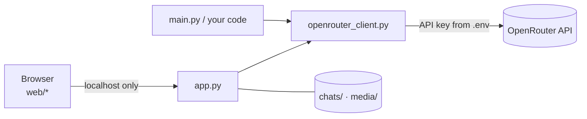

<div align="center">

# OpenRouter Studio

**One API key. Every kind of model. Inputs and outputs that fit each one.**

A local, AI-Studio-style web app, a command-line tool and a small Python library for
[OpenRouter](https://openrouter.ai): chat with GPT, Gemini and Claude, ask decision models like
**Jev** for typed answers, and generate images, video and speech, all with live prices.




</div>

---

## Contents

- [Highlights](#highlights)
- [Quick start](#quick-start)
- [The web studio](#the-web-studio)
  - [Model modes](#model-modes-input-and-output-follow-the-model)
  - [Structured input and output](#structured-input-and-output)
  - [Live prices](#live-prices)
  - [Usage and limits](#usage-and-limits)
  - [Everything else](#everything-else)
- [Command line](#command-line)
- [Python library](#python-library)
- [Model short names](#model-short-names)
- [Project layout](#project-layout)
- [Configuration](#configuration)
- [Privacy and security](#privacy-and-security)
- [Troubleshooting](#troubleshooting)

---

## Highlights

| | |
|---|---|
| **600+ models, 8 modes** | Chat, Decide, Extract, Image, Video, Speech, Transcribe and Embed. Each model gets the inputs and outputs it actually supports. |
| **Typed results** | Structured output for chat models (boolean, number, choice, list, date…), typed answers from Jev, and fields from extraction models. Export as JSON or CSV. |
| **Live prices** | Pulled from OpenRouter every 5 minutes, in each model's own unit, with per-provider prices, an estimate before you run and the exact cost after. |
| **Your spending** | Your key's limit, what's left, and spend today, this week and this month. |
| **Local and private** | Runs on `localhost`. Your API key stays in `.env` and never reaches the browser. Only dependency: `requests`. |

## Quick start

```bash
cd openrouter-studio              # the project folder

python3 -m venv .venv && source .venv/bin/activate
python -m pip install -r requirements.txt   # use 'python -m pip', not bare 'pip'
python app.py          # opens http://localhost:8000
```

> **Tip:** Inside the venv, always use `python -m pip` instead of bare `pip`.
> On some macOS setups, `pip` is aliased to the system Python, which would install
> packages outside your virtual environment.

Or install it as a proper package (gives you the `openrouter-studio` and `openrouter` commands):

```bash
cd openrouter-studio
source .venv/bin/activate
python -m pip install -e .
openrouter-studio      # opens http://localhost:8000
openrouter "Hello"     # CLI tool
```

On first start the page asks for your API key ([get one here](https://openrouter.ai/keys)) and
saves it to `.env`. Prefer the terminal? Run `python main.py --setup`, or copy `.env.example` to
`.env` and paste the key in.

---

## The web studio

### Model modes: input and output follow the model

OpenRouter says what every model takes in and gives back. The studio reads that and gives each
model the right workspace. Press **Ctrl+K** to open the model picker and choose a tab:

| Mode | Example models | You give it | You get back |
|---|---|---|---|
| **Chat** | GPT, Gemini, Claude, DeepSeek, Grok | text, plus what the model reads: images, PDFs, audio (or the mic), video | text, its thinking, spoken audio for audio models, or [typed JSON](#structured-input-and-output) |
| **Decide** | **Jev**, GPT-6 Luna Decisions, Clef | an item and your **questions** | probabilities: yes/no, pick one, a score on your scale, or a box drawn on the image |
| **Extract** | Cloudflare Clairic | text (plus images or PDFs) and the **fields** you want | typed fields with confidence, highlighted in your text |
| **Image** | GPT Image, Gemini Image, FLUX | a prompt (plus reference images) | images, with the settings each model supports |
| **Video** | Veo, Grok Imagine, Gemini Omni | a prompt (plus first and last frames) | a video. The job runs in the background, even across reloads. |
| **Speech** | OpenAI, Gemini and AssemblyAI voices | text, voice, speed | an audio file |
| **Transcribe** | Whisper, Scribe | audio (upload or record) | text, with timestamps if you want |
| **Embed** | Cohere Embed, Nemotron | one text per line | vectors and a similarity heatmap |

- The attach button only accepts what the current model can read.
- The composer shows the model's **input → output** icons.
- Models that do two things, like Gemini Image (chat and image), get a mode switch in the top bar.



### Structured input and output

Jev answers with typed values, and so can other models:

- **Structured output for chat.** Click the **`{ } JSON`** chip, then define the output fields:
  text, number, whole number, **boolean**, choice, list or date. Fields can be optional (`null`
  allowed), and you can ask for a **list of items**.
  - 308 models enforce the structure as a strict JSON Schema.
  - Models with only a JSON mode get the structure as instructions.
  - Every reply is checked against your structure and shown as a typed card (or a table for
    lists), with **Copy JSON**, **JSON** and **CSV** buttons.
- **Input fields.** Split your input into named fields such as `customer_tier` and `ticket`, and
  the composer becomes a form. This works in Chat, Decide (Jev gets a JSON object) and Extract.
- **Decide (Jev).** Along with the probability bars you get a typed result, for example
  `{"is_bug": true, "team": "payments", "urgency": 1.8}`. A yes/no answer becomes `true` when
  its probability reaches the threshold you set (default 50%).
- **Extract.** Field types are text, number (with unit and decimals), date, time, date & time,
  duration, list and estimate (with a likely range). Each comes with a confidence, and your text
  is highlighted where each value was found.

Templates to start from: ticket triage, contact details, action items, product review, invoice
and product listing.



### Live prices

- Prices come **live from OpenRouter**. They refresh by themselves every 5 minutes, or press ⟳.
  A toast appears if your model's price changes.
- Each model is shown in **its own unit**:
  - per 1M tokens for chat, decisions, extraction and embeddings
  - per 1M characters for speech
  - per minute for transcription
  - per image or per token for images
  - per second, by resolution, for video
  - plus thinking, cache, audio and long-context prices
- **Providers:** every provider serving the model, with its live price, uptime and discounts.
- **Before you run:** an estimate, e.g. "≈ $0.10 for 5 s at 480p".
- **While it runs:** a cost counter that rises as a chat reply streams in.
- **After:** the exact cost of every reply, a total for the chat, and your remaining credits.

### Usage and limits

Click the wallet button at the bottom of the sidebar:

- **Spending limit** of your key: a progress bar, how much is left, the reset period
  (daily, weekly or monthly) and the next reset
- **Spent with this key:** today, this week, this month and all time
- **Budgets** from guardrails, **free-model requests** left today, and when the key **expires**
- **Account balance**, if your key is allowed to read it (OpenRouter shows this only to management keys)
- **Spent in this app**, by model and mode, from the exact costs saved in your chats

The same in the terminal: `python main.py --usage`.

### Everything else

- **Run settings:** temperature, thinking effort (from the model's own list), max tokens, top-P,
  stop sequences, seed
- **Every message:** system instructions, Markdown with code highlighting, edit, rerun, copy, delete,
  and **Stop** mid-reply
- **Get code** turns the current chat or run into Python (this library), Python `requests`, cURL or JSON
- **Export** a chat to Markdown
- **History:** chats are saved locally and listed in the sidebar, with search
- **Themes and layout:** dark and light themes, and it works on phones

| Shortcut | Action |
|---|---|
| `Ctrl` + `K` | Open the model picker |
| `Enter` / `Shift` + `Enter` | Run / new line (in Embed: `Ctrl` + `Enter` runs) |
| `Ctrl` + `Enter` | Save an edited message, or run from the system instructions |
| `Esc` | Close dialogs and panels |

---

## Command line

```bash
python main.py "What is Python?"                         # default model (gpt)
python main.py -m gemini "Explain black holes"           # pick a model by short name…
python main.py -m openai/gpt-5.5 "Hi"                    # …or by any OpenRouter id
python main.py -m gpt,claude,gemini "Tell a joke"        # same prompt, several models

python main.py -m claude -i input.txt -o output.txt      # file in, file out
python main.py -i report.txt "Summarize this:"           # prompt + file content
cat notes.txt | python main.py -m deepseek               # read from stdin

python main.py --chat -m claude                          # interactive chat (/model, /clear, /exit)
python main.py --usage                                   # your key's limit and spending
```

| Option | What it does |
|---|---|
| `-m, --model` | Short name or full id. Separate several with commas to compare them. |
| `-i, --input` / `-o, --output` | Read input from a file (`-` = stdin) / write the answer to a file |
| `-s, --system` | System prompt |
| `-t, --temperature`, `--max-tokens` | Sampling settings |
| `--no-stream` | Print the answer only when it's complete |
| `-v, --verbose` | Show the model used, tokens and cost |
| `--chat` | Interactive chat |
| `--setup` | Save and check your API key |
| `--aliases` | List the short model names |
| `--list-models [TEXT]` | Search all models, with prices |
| `--usage` | Your key's limit and spending |

---

## Python library

`openrouter_client.py` is a single file you can import anywhere.

```python
from openrouter_client import OpenRouterClient

client = OpenRouterClient()   # reads OPENROUTER_API_KEY from the environment or .env

print(client.ask("Hello!", model="gemini"))
print(client.ask("I love coding", model="claude", system="Translate to French", temperature=0))

for piece in client.ask_stream("Write a haiku", model="deepseek"):   # streaming
    print(piece, end="", flush=True)

print(client.last_usage)       # tokens and cost of the last call
```

**Typed results**

```python
# Structured output: get a dict that follows your JSON Schema
schema = {
    "type": "object",
    "properties": {"is_bug": {"type": "boolean"}, "priority": {"type": "integer"}},
    "required": ["is_bug", "priority"],
    "additionalProperties": False,
}
data = client.ask_json("My checkout page is blank after I click Pay.", schema, model="gpt")

# Decision model (Jev): probabilities for your questions
result = client.decide(
    state="My checkout page is blank after I click Pay.",
    questions={"is_bug": {"type": "noul", "instructions": "Is this a software defect?"}},
    model="jev",
)
print(result["answers"]["is_bug"]["noul"])   # e.g. 0.96

# Extraction model: typed fields from text
client.extract(state="Invoice INV-2291 … Total $1080.", fields={"total": {"type": "number", "unit": "USD"}},
               model="cloudflare/clairic")
```

**Other model types**

```python
client.generate_image("a watercolor fox", model="openai/gpt-image-2.6-flare", aspect_ratio="16:9")
audio, info = client.speech("Hello!", model="assemblyai/assemblyai-tts-1", voice="aai-sara")
client.transcribe(open("talk.mp3", "rb").read(), "mp3", model="elevenlabs/scribe-v2")
job = client.create_video("a drone shot over mountains", model="x-ai/grok-imagine-video-1.5-lite", duration=5)
client.get_video(job["id"])          # poll until "completed", then client.download_video(job["id"])
client.embed(["first text", "second text"], model="cohere/embed-5-fast")
client.key_info()                    # your key's limit and usage
```

Extra keyword arguments (`temperature`, `max_tokens`, `reasoning`, `provider`, …) go straight to the
[OpenRouter API](https://openrouter.ai/docs). Errors raise `OpenRouterError`.
`example.py` has a runnable tour.

---

## Model short names

You can use these anywhere a model id is accepted.

| Alias | Model | | Alias | Model |
|---|---|---|---|---|
| `gpt` (default) | `openai/gpt-6.1-sol` | | `deepseek` | `deepseek/deepseek-v4-pro` |
| `gpt-mini` | `openai/gpt-6-luna` | | `grok` | `x-ai/grok-4.7` |
| `gemini` | `google/gemini-4-argon` | | `llama` | `meta-llama/llama-4-maverick` |
| `gemini-flash` | `google/gemini-3.8-flash` | | `mistral` | `mistralai/mistral-large-4-0` |
| `claude` | `anthropic/claude-sonnet-5.5` | | `qwen` | `qwen/qwen3.7-plus` |
| `claude-opus` | `anthropic/claude-opus-5.5` | | `free` | `google/gemma-4-31b-it:free` |
| `claude-haiku` | `anthropic/claude-haiku-5.5` | | `jev` | `~typesafe/jev-latest` (decision model) |

Edit `MODEL_ALIASES` and `DEFAULT_MODEL` in `openrouter_client.py` to change them.

---

## Project layout

```
openrouter/
├── app.py                  # web studio server (Python standard library + requests)
├── web/
│   ├── index.html          # page layout
│   ├── style.css           # dark/light themes, responsive layout
│   ├── app.js              # core: chats, composer, chat streaming, model picker
│   ├── modes.js            # Decide, Image, Video, Speech, Transcribe, Embed
│   ├── structured.js       # input fields, output structure, Extract mode
│   └── pricing.js          # live prices, estimates, usage & limits
├── openrouter_client.py    # the Python library (OpenRouterClient + model aliases)
├── main.py                 # command-line tool
├── example.py              # library examples
├── docs/screenshots/       # images used in this README
├── requirements.txt
├── .env.example            # template for your API key
├── .env                    # your API key (not committed)
├── chats/                  # saved chats, one JSON file each (not committed)
└── media/                  # generated images, audio and videos (not committed)
```



## Configuration

| What | Where |
|---|---|
| API key | `OPENROUTER_API_KEY` in `.env`, or an environment variable (the environment variable wins) |
| Port / browser | `python app.py --port 9000 --no-browser` |
| Short names and default model | `MODEL_ALIASES` and `DEFAULT_MODEL` in `openrouter_client.py` |
| Saved chats / generated files | `chats/` and `media/` (deleting a chat also deletes its files) |
| Theme, recent models, last settings | your browser's local storage |

## Privacy and security

- The server only listens on `127.0.0.1`.
- It rejects requests from other websites: it checks the `Host` header, and every change needs a
  same-origin JSON request.
- Your API key is read on the server and **never sent to the browser**. `.env` is saved with
  owner-only permissions (`600`).
- Chats and generated files stay on your disk. Only your prompts and files go to OpenRouter and the
  model's provider.

## Troubleshooting

| Problem | Fix |
|---|---|
| `Can't use port 8000` | Something else is using it. Run `python app.py --port 8001`. |
| "No API key found" | Run `python main.py --setup`, or use the key dialog in the web app. |
| `HTTP 401` | The key is wrong or revoked. Replace it from the wallet button → **Change key**. |
| `HTTP 402` | Out of credits, or the key hit its spending limit. Check the wallet button. |
| "model can't take … input" | That model doesn't accept that file type. Pick one with the right input icon. |
| Account balance not shown | OpenRouter shows it only to management keys. See [openrouter.ai/settings/credits](https://openrouter.ai/settings/credits). |
| Price shows "varies" | Router models (like `openrouter/auto`) charge the price of whichever model they pick. |
| The page looks old after an update | Restart `python app.py` and hard-refresh the page (`Ctrl` + `Shift` + `R`). |

> OpenRouter's batch, rerank and some brand-new endpoints aren't in the studio yet. You can still
> call any of them with `OpenRouterClient` and plain `requests`.
